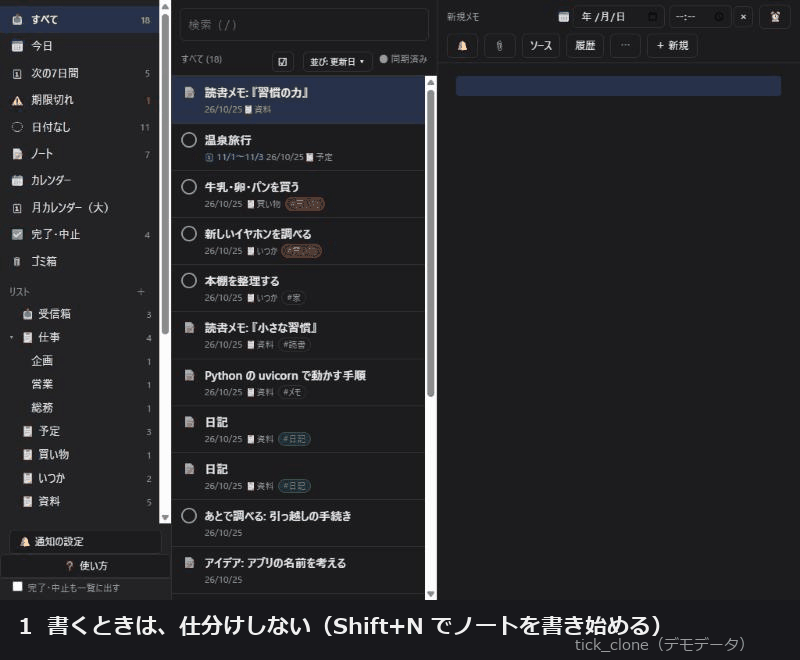
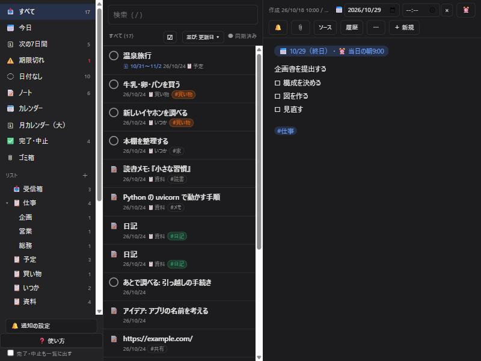
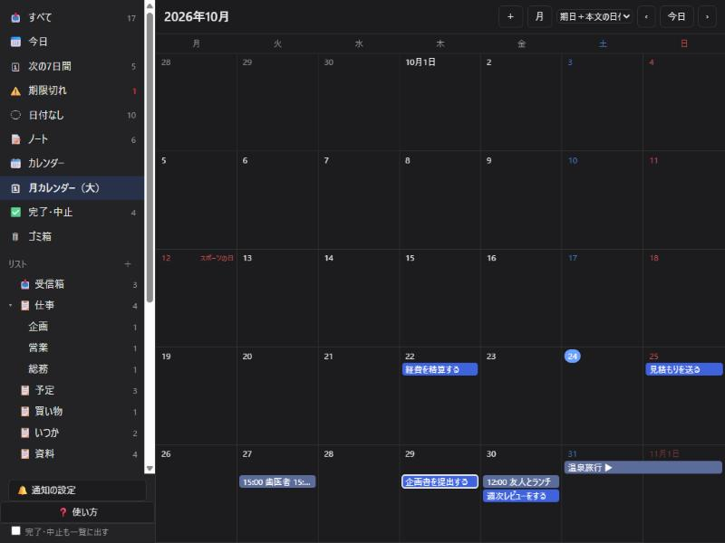
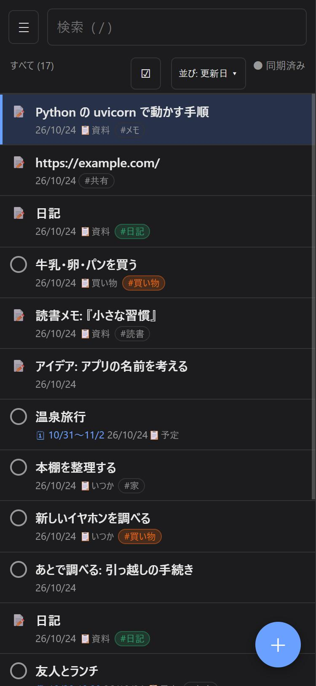

# tick_clone

**自分の PC で動かす、メモ・タスクアプリ。** TickTick のような使い心地（リスト・タグ・カレンダー・日付・繰り返し・通知）を、**1メモ = 1つの Markdown ファイル**で。データは自分の手元に残り、アプリが無くなっても、メモは読めます。

> **English: see [README.en.md](README.en.md).** Summary: a self-hosted, single-user notes & tasks app (FastAPI + SQLite index + plain JavaScript PWA). Each note is one Markdown file with a small front-matter; the SQLite index can always be rebuilt from the files. Lists, tags, calendar, due dates & repeats, push notifications, offline PWA, Chrome extension, TickTick CSV import. **No login — keep it on `127.0.0.1` or a private network such as Tailscale. Never expose it to the public internet.** UI and docs are in Japanese.

> **書く時は、仕分けしない。仕分けは、アプリが済ませる。**
> **あなたのメモは、ただのファイル。アプリが無くなっても、残る。**





| 月カレンダー | スマホ |
|---|---|
|  |  |

---

## ⚠ 最初に読んでください：既定では、ログインがありません

- 既定では、**パスワードなどの認証がありません。** 開ける人は、メモを全部読めて、書き換えられます。
- 既定では、**自分の PC の中だけ**（`127.0.0.1`）で動きます。スマホなどから使うときは、**Tailscale のような、自分の端末だけがつながる回線**を使ってください。
- **インターネットへ公開しないでください**（ポート開放、`tailscale funnel`、公開用のトンネルなど）。
- メモの本文は、サーバーの PC に、そのまま（暗号化なしで）保存されます。

### 念のための鍵：アクセストークン（任意）

環境変数 **`TICK_TOKEN`** を決めて起動すると、**トークンを知っている人だけ**が使えます（ブラウザは `/login` で入力。Chrome 拡張はオプションに入力）。

```bash
python -c "import secrets; print(secrets.token_urlsafe(24))"     # 長いランダムな文字列を作る
# Windows の PowerShell:  $env:TICK_TOKEN="作った文字列"; python -m uvicorn main:app --app-dir app --host 127.0.0.1 --port 8765
# Mac / Linux:            TICK_TOKEN="作った文字列" ./start.sh
```

- 設定しなければ、これまでどおり（認証なし）です。
- ログインしたブラウザには、**トークンそのものではなく、そこから作った印**が、Cookie（HttpOnly）で残ります（1年）。失敗が続くと、しばらく受け付けません。
- **これは、「公開しても安全」にする機能ではありません。** トークンは、1つだけで、通信を暗号化しません。**HTTPS 越し（`tailscale serve` など）**で使ってください。インターネットへの公開は、引き続き、おすすめしません。

---

## 特徴

- **メモは、ただのファイル。** 1件 = Markdown ファイル1つ（`data/notes/年/月/ID.md`）。**エディタで開けて、`grep` で探せて、スクリプトで読み書きできて、git で履歴が残ります。** 検索・一覧を速くする索引（SQLite）は、消しても作り直せます。形式は [docs/ファイル形式.md](docs/ファイル形式.md)。**データは、自分のPCの中だけ**（クラウドにも、アカウントにも、預けません）。
- **整形表示のまま書ける**（行ごとに編集）。箇条書き・チェックボックス・画像・PDF・URL のタイトル自動取得。
- **リスト**（フォルダ/リストの2階層）・**タグ**（階層・色）・**フィルター**（条件を組み合わせて保存）・**ノートとタスクの区別**。
- **日付・時刻・予定と締切・複数日・繰り返し・リマインダー**（プッシュ通知）。本文の日時（「来週の日曜のお昼」など）から、日付を提案。
- **カレンダー**（小さいもの・月カレンダー（大））。完了日・中止（キャンセル）の記録。
- **自動振り分け**: 締切・予定・ノートにしたとき、締切が近づいたとき、フィルターに当てはまったとき、決めたリストへ自動で入る。
- **複数選択・まとめて操作・元に戻す**、ドラッグ&ドロップ、キーボード操作、コマンドパレット。
- **PWA**: スマホのホーム画面に追加でき、**オフラインでも**使えて、つながったときに同期されます。Android の「戻る」ボタンにも対応。
- **Chrome 拡張**: ページ・選んだ文章・画像を、右クリックで追加（`extension/`）。
- **履歴**: メモの変更は、データフォルダの git に自動で記録され、過去の版へ戻せます。ゴミ箱から戻せます。
- **TickTick の CSV 書き出し**から取り込み（`tools/import_ticktick.py`）。

操作の説明は、アプリの中の「❓ 使い方」（キーボードの `?`）、または [docs/使い方.md](docs/使い方.md)。作りの説明は [docs/設計.md](docs/設計.md)。

---

## 動かす（5分）

必要なもの: **Python 3.10 以上**、**git**（変更履歴の記録に使います）。

```bash
git clone https://github.com/masarusama/tick_clone.git
cd tick_clone
python -m venv .venv
# Windows: .venv\Scripts\activate      Mac/Linux: source .venv/bin/activate
pip install -r requirements.txt
```

起動:

| OS | コマンド |
|---|---|
| Windows | `start.bat`（ダブルクリックでも） |
| Mac / Linux | `./start.sh` |
| どれでも | `python -m uvicorn main:app --app-dir app --host 127.0.0.1 --port 8765` |

ブラウザで **http://127.0.0.1:8765/** を開きます。データは、初回の起動で `data/` に作られます（場所は、環境変数 `TICK_DATA` で変えられます）。

### まず試したいとき（デモデータ）

```bash
python tools/seed_demo.py                  # data-demo/ に、架空のメモ・リスト・フィルターを作る
TICK_DATA=data-demo python -m uvicorn main:app --app-dir app --host 127.0.0.1 --port 8765
# Windows の PowerShell:  $env:TICK_DATA="data-demo"; python -m uvicorn main:app --app-dir app --host 127.0.0.1 --port 8765
```

---

## スマホなど、ほかの端末から使う

1. PC とスマホに [Tailscale](https://tailscale.com/) を入れて、同じアカウントで入ります。
2. PC で: `tailscale serve --bg 8765`（HTTPS のアドレス `https://<PC名>.<tailnet名>.ts.net/` が出ます。**`tailscale funnel` は使わないでください**）。
3. スマホの Chrome で、そのアドレスを開き、メニューから「ホーム画面に追加」。
4. 通知を使うなら、アプリの 🔔 から有効にします（通知の鍵は `data/push/` に作られます。**これは共有しない**）。

## PC の起動時に、自動で立ち上げる

- **Windows**（タスクスケジューラ。ログオン時に、見えない状態で起動する例）:
  ```powershell
  $py = (Get-Command pythonw).Source
  $a = New-ScheduledTaskAction -Execute $py -Argument "-m uvicorn main:app --app-dir app --host 127.0.0.1 --port 8765" -WorkingDirectory "C:\path\to\tick_clone"
  $t = New-ScheduledTaskTrigger -AtLogOn
  Register-ScheduledTask -TaskName tick_clone_server -Action $a -Trigger $t
  ```
- **Mac**: launchd、**Linux**: systemd のユーザーサービスなどに、上の「どれでも」のコマンドを登録します。

## バックアップ

```bash
python tools/backup.py --dest /path/to/backup/folder    # 環境変数 TICK_BACKUP_DIR でも指定できる
```

メモ＋履歴を日付入りの zip（14世代）に、添付を差分でコピーします。毎日動かすには、タスクスケジューラや cron に登録します。**通知の鍵（`data/push/`）は、バックアップに入りません。**

## TickTick から取り込む

TickTick の設定 → アカウント → データのバックアップ（CSV）を書き出して:

```bash
python tools/import_ticktick.py export.csv --data data
```

フォルダ/リスト → `list:`、ノート/タスク → `kind:`、完了・中止・日付・繰り返し・優先度・タグを引き継ぎます。同じファイルを何度流しても、重複しません。

## Chrome 拡張（右クリックで追加）

`chrome://extensions` →「デベロッパー モード」→「パッケージ化されていない拡張機能を読み込む」→ `extension/` フォルダ。オプションで、先に試すアドレス（Tailscale のアドレスなど）を入れられます。何も入れなければ `http://localhost:8765` へ送ります。

---

## テスト

```bash
python tools/run_tests.py             # 1つずつ、新しい空のデータフォルダで走らせます（実データには触れません）
python tools/run_tests.py --network   # インターネットにつなぐテスト（リンクのタイトル取得）も
```

## しくみ（ざっくり）

```
ブラウザ（PC・スマホの PWA。オフラインは端末内 IndexedDB に保存 → つながったら同期）
        │
FastAPI（app/main.py）── data/notes/*.md（正本・data/ 自体が git）
                      └─ data/index.db（SQLite の索引・消えても作り直せる）
```

- 画面はビルド不要の素の JavaScript（ES modules）。`app/static/`
- サーバー: Python + FastAPI。メモの入出力は `app/store.py`
- リポジトリに含まれるのは、プログラムだけです。**あなたのメモ（`data/`）は、含まれません。**

## 注意・ライセンス

- 個人の開発物です。**TickTick とは関係のない、非公式のものです**（名前は、使い心地の参考にしただけ）。
- 画面・文書は、日本語です。
- **日時は、日本時間（JST, +09:00）で記録します**（ほかのタイムゾーンへの対応は、まだです）。
- 1人用です（複数人での共有・権限の管理は、ありません）。
- ファイルを外から直したときは、サーバーの再起動で、取り込まれます（[docs/ファイル形式.md](docs/ファイル形式.md)）。
- 動作の保証はありません。大事なメモは、バックアップを取ってください。
- ライセンス: [MIT](LICENSE)
